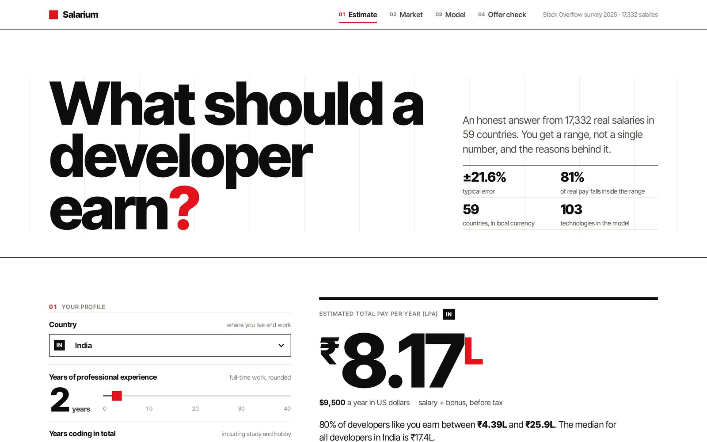
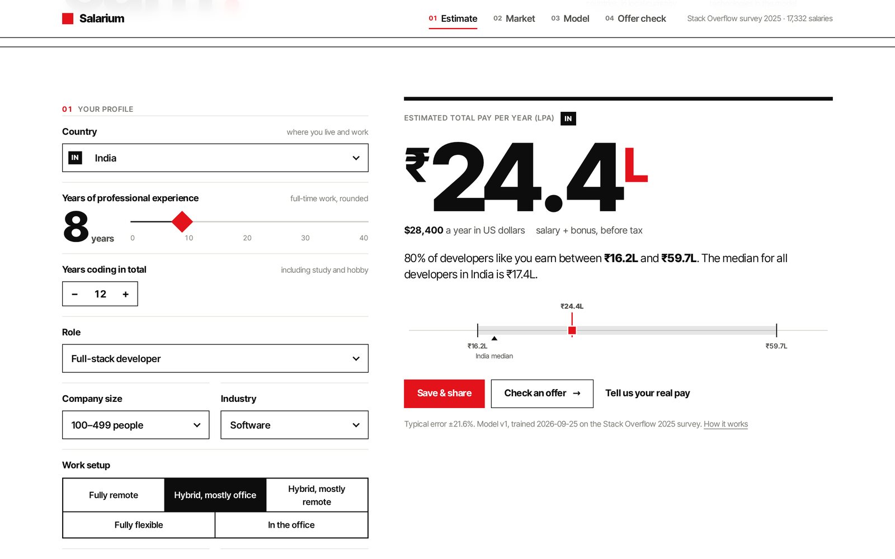
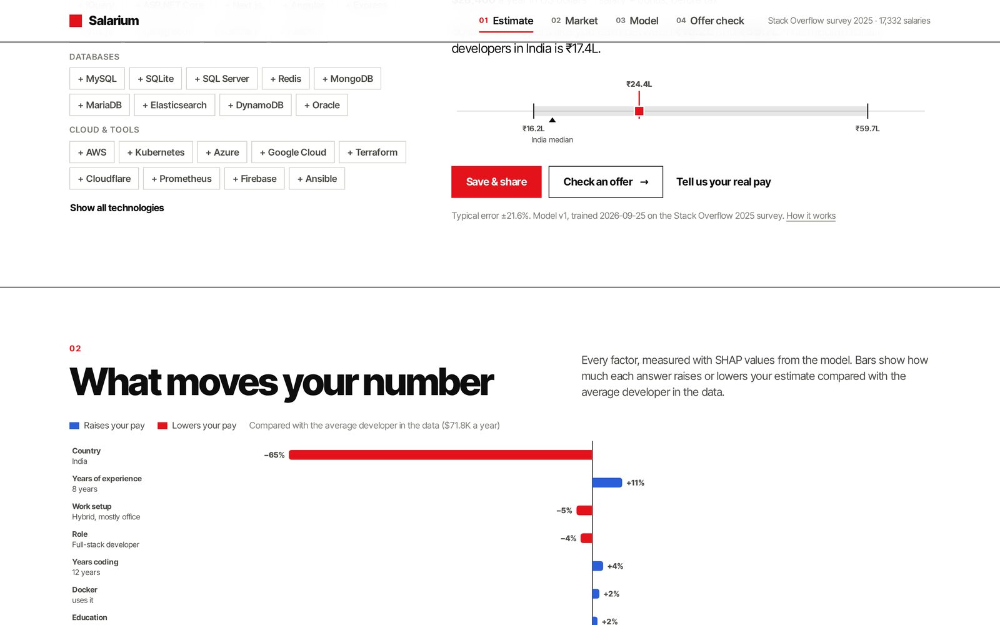
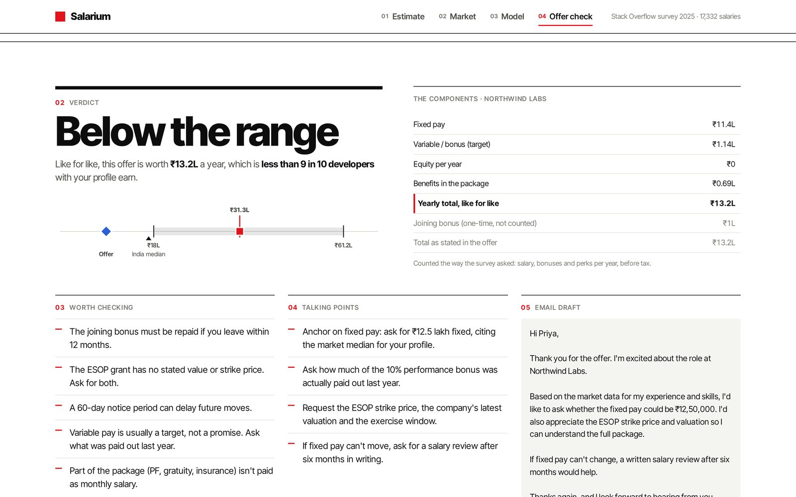
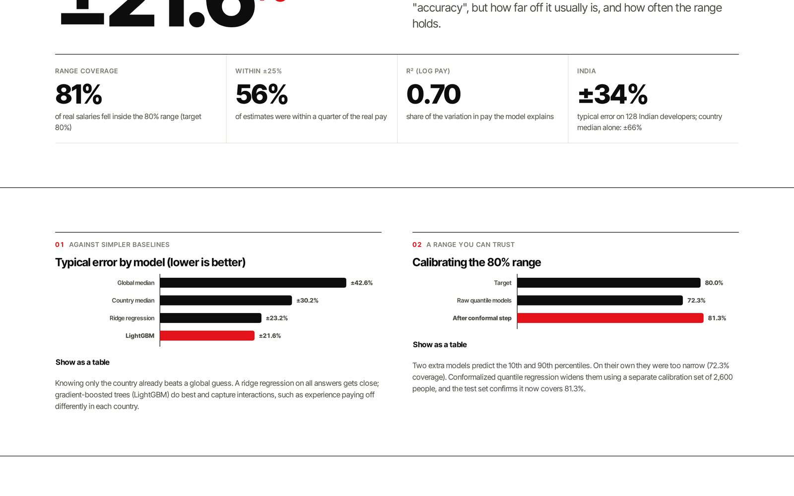
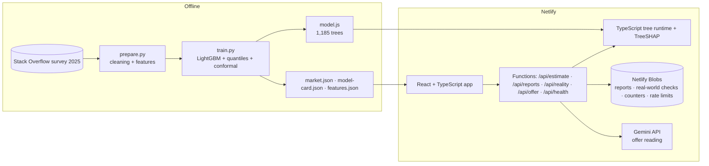
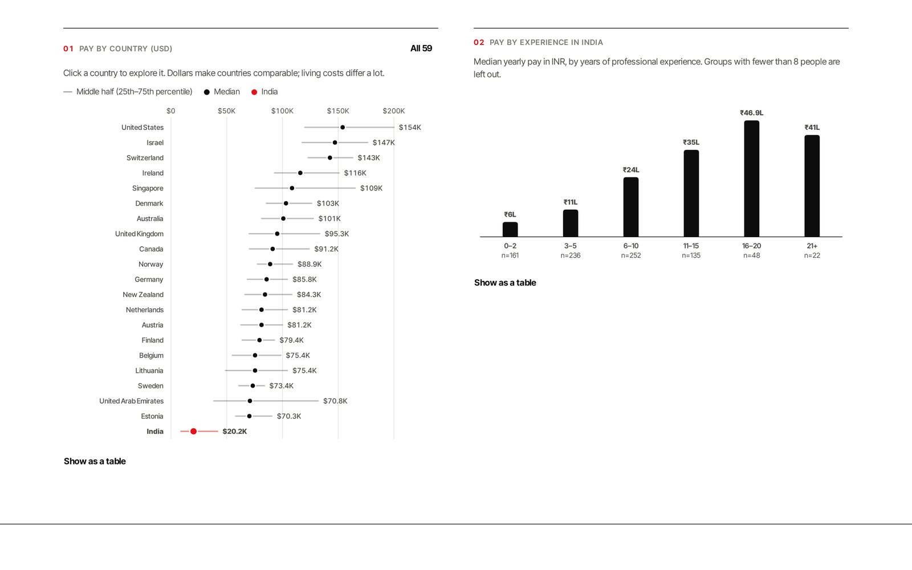
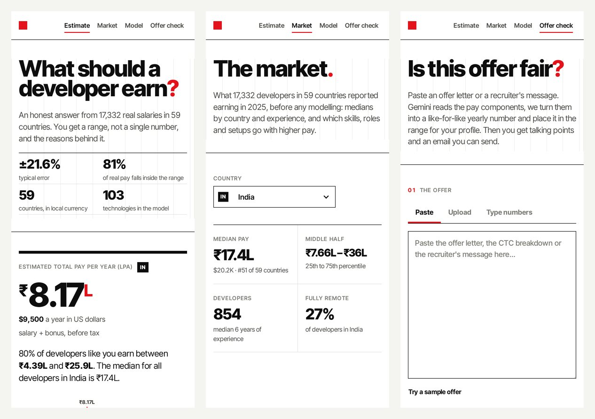

# Salarium

**What should a software developer earn?** Salarium gives an honest answer: an estimate *and* the range where 80% of similar developers actually land, the reasons behind the number (SHAP), how it grows with experience, which skills go with higher pay, and an AI check of real job offers. It's trained on 17,332 real salaries from the Stack Overflow Developer Survey 2025 across 59 countries, and shows every country in its own currency (Indian pay in lakhs per year).

**Live:** https://salarium-nishant.netlify.app &nbsp;·&nbsp; **Author:** [Nishant Singh](https://nishant-singhaa0240274.netlify.app)



## Features

- **Estimate with a range.** A LightGBM model predicts total yearly pay; two quantile models, calibrated with conformal prediction, give the 80% range. It's in local currency, with the country median marked for comparison.
- **What moves your number.** Exact SHAP values for every estimate: how much your country, experience, role, company size, work setup and each technology raise or lower pay compared with the average developer in the data.
- **Your next 30 years.** The same profile at every level of experience, with the range as a band. A monotone constraint means more experience never lowers the estimate.
- **What-ifs.** The technologies most linked to higher pay for *your* profile (add one with a click and the estimate updates), and the same profile in every other role.
- **Market data.** Median pay by country (middle half shown), pay by experience for any country, and pay premiums for 103 technologies, roles and work setups, **controlling for country and experience**, with 95% confidence intervals.
- **Model card.** Test-set accuracy against simpler baselines, range calibration, accuracy by country, feature importance, every data-cleaning step, method and limits.
- **Offer check (Gemini).** Paste an offer letter or upload a PDF or image. Gemini extracts fixed pay, variable pay, equity, benefits and joining bonus (it understands Indian CTC and "LPA"). Salarium converts it to a like-for-like yearly total, places it in your range with an approximate percentile, and writes talking points and a negotiation email. You can also type the numbers without AI.
- **Real-world accuracy.** Visitors can anonymously check an estimate against their actual pay (rounded to $500, no identity stored). The model page shows the live score next to the test-set score.
- **Save & share.** Shareable report links (`/r/…`) that recompute the estimate on view.









## The model

| Model (test set, 2,600 people) | Typical error (MdAPE) | R² (log pay) | Within ±25% |
|---|---|---|---|
| Global median | ±42.6% | –0.03 | 32% |
| Country median | ±30.2% | 0.54 | 43% |
| Ridge regression | ±23.2% | 0.69 | 53% |
| **LightGBM** | **±21.6%** | **0.70** | **56%** |

- **80% range coverage:** the raw quantile models covered 72.3% of real salaries. After **conformalized quantile regression** on a separate calibration set, the range covers **81.3%** of the test set.
- **India:** ±34% typical error on 128 Indian test cases, versus ±66% for the country median alone.
- Salary data is noisy: two people with identical answers can earn very different amounts. That's why the site reports typical error and a calibrated range rather than an "accuracy" percentage.

**Pipeline** (`python/`)
1. `download.py` fetches the survey (141 MB) from Stack Overflow's official archive.
2. `prepare.py` keeps professional developers who are employed or self-employed and reported pay, then removes outliers **within each country** (Tukey's fences on log pay, which catch monthly salaries typed into the yearly box). Countries need at least 30 clean responses. The result: 49,191 → 17,332 responses, 59 countries and 104 technologies. Local currencies use the exchange rates implied by the survey itself.
3. `train.py` uses a 70 / 15 / 15 train / calibration / test split, stratified by country. It trains the baselines, the ridge model (one-hot + splines) and LightGBM with native categorical splits and a monotone constraint on experience; settings come from 5-fold cross-validation on the training set only. It then fits the quantile models and conformal adjustment, computes SHAP importance and the market analysis, and exports everything.

**Serving without Python.** The trees are exported to `netlify/model/model.js` and evaluated by a small TypeScript runtime (`shared/model.ts`), which also implements **exact TreeSHAP** (Lundberg et al., 2018). `tests/parity.test.ts` checks it against LightGBM on 300 test rows: predictions and SHAP values match to within 1e-8.

Features: country, years of experience, years coding, role, education, company size, IC or manager, work setup, industry, employment type and 103 technologies. **Age and gender are deliberately not used.**

## Architecture



### API

| Method | Path | What it does |
|---|---|---|
| POST | `/api/estimate` | Profile → range (USD), SHAP drivers, 0–30 year curve, skill and role what-ifs |
| POST | `/api/reports` | Save a profile, get a share id |
| GET | `/api/reports/:id` | A saved report with a freshly computed estimate |
| POST | `/api/reality` | Compare actual pay with the estimate (anonymous) |
| GET | `/api/reality` | Live real-world accuracy |
| POST | `/api/offer` | Offer text, file or numbers → like-for-like total, percentile, advice |
| GET | `/api/health` | Model info, AI status, usage counters |

```bash
curl -X POST https://salarium-nishant.netlify.app/api/estimate \
  -H "content-type: application/json" --data @- <<'EOF'
{ "country": "India", "yearsPro": 3, "role": "Back-end developer",
  "education": "Bachelor's degree", "orgSize": "1,000–4,999",
  "manager": "Individual contributor", "remote": "Hybrid, mostly office",
  "industry": "Software", "employment": "Employee",
  "skills": ["lang_java", "web_spring_boot", "plat_docker"] }
EOF
```

## Tech stack

Python (pandas, scikit-learn, LightGBM) for training · TypeScript everywhere else · React 18 + Vite · Framer Motion · Netlify Functions (Node 22) · Zod · Netlify Blobs · Gemini API (structured JSON output, PDF and image input) · hand-built SVG charts with tooltips and table views.





Design: International Typographic (Swiss) style. White paper, black type, one red, a visible 12-column grid, huge numerals; Inter Tight throughout. Blue marks what raises pay and red what lowers it.

## Run it yourself

```bash
npm install
npx netlify dev                          # http://localhost:8888 (uses the committed model)
```

Retrain from scratch:

```bash
pip install -r python/requirements.txt
python python/download.py && python python/prepare.py && python python/train.py
npm test                                 # parity + estimate checks
```

Deploy on Netlify (build `npm run build`, publish `dist`). The only environment variable is **`GEMINI_API_KEY`** (optional, used for reading offers); add it before the first deploy. `GEMINI_MODEL` can override the model.

## Tests

- `npm test`: the TypeScript runtime against LightGBM (predictions and SHAP), plus estimate sanity checks (ordering, monotone curve, SHAP values that add up, speed).
- `python3 tests/api_test.py`: 28 end-to-end API checks against a local server with a mock Gemini (`tests/mock_gemini.py`), covering validation, reports, anonymous reality checks and rate limits, and offers by text, file and numbers.
- `npm run typecheck`: strict TypeScript.

## Limits

- Stack Overflow survey respondents aren't a random sample of developers. In India especially, they lean towards people working for foreign companies.
- Pay was reported in mid-2025 and isn't adjusted for inflation since.
- Skill premiums are correlations, not causes.

## Data & license

Code: MIT © 2026 Nishant Singh.
Data: [Stack Overflow Developer Survey 2025](https://survey.stackoverflow.co/), made available under the [Open Database License (ODbL 1.0)](https://opendatacommons.org/licenses/odbl/1-0/). The model and statistics on this site are produced works based on that database. The raw survey isn't included in this repository; `python/download.py` fetches it.
